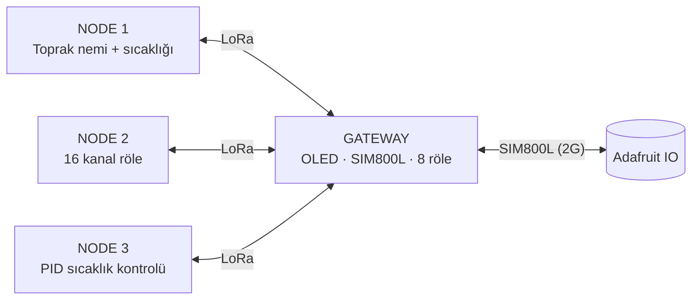

# 🌱 LoRa Tabanlı Sera & Tarla IoT Sistemi

Sera ve tarla için geliştirdiğim, **1 gateway + 3 node**’dan oluşan bir IoT prototipi. Node’lar gateway ile **LoRa (SX1278 / Ra-01)** üzerinden haberleşir, gateway ise verileri **SIM800L** ile **Adafruit IO**’ya aktarır ve sunucudan gelen komutları node’lara iletir.

Tüm yazılım **register seviyesinde (bare-metal)** yazılmıştır. HAL/LL kullanılmadı; sürücüler ve kütüphaneler bana aittir.

---

## 🧭 Sistem Genel Bakış

---

## ⚙️ Nasıl Çalışıyor?

1. **Gateway master’dır.** Node’lara sırayla **okuma** veya **yazma** isteği gönderir.
2. **Node isteği kabul eder.** Okuma isteğinde verileri gönderir; yazma isteğinde gelen değerleri kendi register’larına yazar ve gateway’e **onay** yollar.
3. Gateway bir node’dan cevap alamazsa **5 saniye** bekler ve işlemi **3 kez** dener. Yine olmazsa o node için **hata işaretler** ve yazılım kaldığı yerden devam eder.
4. Sonunda veriler **tek tek sunucuya yazılır**; sunucudan alınan kontrol değerleri de gerekli register’lara yazılır (röleler, PID parametreleri).

Gateway ile node’lar arasında **kendi yazdığım küçük bir LoRa paket protokolü** kullanılır (gönderen/alıcı adresi, işlem tipi, uzunluk, veri; ayrıca adres ve uzunluk kontrolleri). Ayrıntılar kodda.

---

## 🧩 Cihazlar

### 🛰️ Gateway
**STM32F401RCT6** · SX1278 · SIM800L · 0.96" OLED · 8 kanal röle

- Node’lardan gelen verileri toplar ve Adafruit IO’ya yazar.
- Sunucudan gelen komutları node’lara ve kendi 8 rölesine uygular.
- **OLED ekranda** şunlar görülebilir:
  - Node 1, Node 2, Node 3 ve gateway’in değerleri / röle durumları
  - **LoRa hataları**, **node gönderim/alım hataları** ve **SIM800L hataları** (hepsi işaretlenir ve ekrandan izlenir)

### 🌱 Node 1 — Toprak Nemi & Sıcaklığı *(sadece okuma)*
**STM32F401RCT6**
- **Kapasitif toprak nem sensörü**, **hava** ve **su** için iki ayrı **kalibrasyon butonu** var.
- **DS18B20** ile toprak sıcaklığı ölçülür.
- Bu node’da LoRa üzerinden yalnızca **okuma** vardır.

### 🔌 Node 2 — 16 Kanal Röle *(okuma + yazma)*
**STM32F401RCT6** · 16 kanal röle
- LoRa ile **hem okuma hem yazma** yapılır; röleler sunucu üzerinden açılıp kapatılır.
- Fan, su motoru/sulama pompası, solenoid vana, aydınlatma, ısıtıcı, sisleme sistemi, sera pencere motoru… röleyle sürülebilen her şey bağlanabilir.

### 🌡️ Node 3 — PID Sıcaklık Kontrolü *(okuma + yazma)*
**STM32F103C8T6** · SHT31 nem/sıcaklık sensörü
- Sıcaklık **3 saniyede bir** okunur ve **PID fonksiyonunda** işlenir.
- Çıkışlar: **1 adet PWM** ve **1 adet yön çıkışı** (soğutma = 1, ısıtma = 0). İkisi de şu an LED ile modellenmiştir.
- Araya bir güç katmanı konularak sera/ortam sıcaklığı PID ile dengelenebilir.
- **İstenen sıcaklık ve Kp, Ki, Kd** değerleri sunucudan belirlenir, gateway üzerinden node’a gönderilir.

> Her node’un üzerinde **sinyal LED’i** bulunur.

---

## 🛡️ Dayanıklılık

Proje, **reset atmaması** için özel olarak tasarlandı; bir parça bozulsa bile sistemin geri kalanı çalışmaya devam eder.

- **Watchdog (IWDG):** Tüm cihazlarda etkin. Gateway’de **~30 sn**, node’larda **~10 sn**. Güncel kullanımda watchdog kaynaklı reset yaşanmadı.
- **Node’a ulaşılamazsa:** 3 deneme sonrası hata işaretlenir, sistem devam eder.
- **SIM kart bulunamazsa / internet gelmezse:** İlk açılışta SIM800L ayarı yapılamasa bile sistem açılır. Ana döngüde STM32 periyodik olarak SIM800L’den IP alıp almadığını sorgular; alamıyorsa **SIM800L ayarını baştan başlatır** ve internete bağlanmayı tekrar dener. Bağlanamazsa bile **LoRa ve diğer tüm sistemler çalışmaya devam eder.**

---

## ☁️ Adafruit IO ve Hız

Adafruit IO ücretsiz planda **10 adet değiştirilebilir feed** sunar ve işlemler arasında **en az 2 saniye** bekletir. Bu, projenin **yavaş çalışmasının en büyük nedenidir.** Bu yüzden sistem hızlı kontrol için değil, **yavaş değişen büyüklükler** (toprak nemi, sera sıcaklığı, sulama gibi) için uygundur.

---

## ⚠️ Eksikler ve Sınırlamalar

Bu proje bir **prototiptir** ve geliştirmeye açıktır.

- **HTTPS yok:** SIM800L HTTP destekliyor, HTTPS desteklemiyor. Araştırmalarıma göre bu, sistemde **güvenlik açığı** oluşturuyor.
- **2G bağımlılığı:** SIM800L 2G kullandığı için internet işlemleri yavaş olabiliyor. Ayrıca bazı ülkelerde **2G’nin yakın tarihte kapatılması** bekleniyor; bu büyük bir eksi.
- **Adafruit IO limitleri:** 10 feed ve ≥2 sn işlem aralığı (yukarıya bakın).
- **Menzil:** Açık alanda deneyemedim. Bina içinde, gateway **1. kattayken** **−2. kattaki** Node 1’den kesintisiz veri geldiğini gözlemledim. LoRa ayarları **en uzak menzile göre** yapılandırıldı. Fiyat/performans için **SX1278** kullandım; daha uzun menzil için LoRa’nın diğer modülleri tercih edilebilir.
- **Node 3 MCU’su:** İlk plan STM32F401RCT6’ydı. Yedek olarak aldığım iki adet bozulduğu ve yenisi temin edilemediği için **STM32F103C8T6**’ya geçtim.
- **16 kanal röle kartı:** Kartı bastırdım ama FR2 malzeme olduğu için kalite yetersiz kaldı ve yollar ince olduğundan sorun çıkardı. Bu yüzden demoyu **breadboard ve jumper** ile yaptım. Breadboard’da 2–3 röle sorun çıkarıyor; basılı kartta 16 kanalın hepsi çalışıyor.

---

## 🚀 Geliştirme Fikirleri

- LTE-M / NB-IoT / 4G modül ve **HTTPS veya MQTT (TLS)**
- Kendi sunucu / MQTT broker (Adafruit IO limitlerinden kurtulmak için)
- Açık alan menzil testleri
- Düşük güç modu (batarya / solar kullanım)
- **Gateway ve Node 2’nin (16 kanal röle) adaptörle şebekeden beslenmesi:** Tüm röleler açıkken Node 2 ciddi akım çeker ve bataryayı çok hızlı bitirir. Bu iki cihazın şebekeden beslenmesi çok daha sağlıklı olacaktır.
- 16 kanal röle kartının kaliteli PCB ile yeniden üretimi

---

## 🤖 Yapay Zekâ Kullanımı

Bu benim **ilk büyük projem.** Yapay zekâyı günümüz şartlarına uygun şekilde **asistan olarak** kullandım:

- Yazılımdaki **zaman alan ve kendini tekrar eden işleri** (özellikle `.h` dosyalarındaki `define` ve `enum` tanımları) istekler doğrultusunda yapay zekâya yazdırdım.
- Bazı modüllerin **çalışma prensiplerini öğrenmek** için kullandım.
- Zamandan tasarruf için **bazı belirli fonksiyonlar doğrudan yapay zekâyla yazıldı**; bunlar kod dosyalarında **yorum satırıyla** belirtilmiştir.

Mimari, sistem tasarımı ve sürücülerin mantığı bana aittir.

---

## 🎥 Demo

İlgilenen ve anlattıklarımdan tatmin olmayan kişiler için **çalışırken kaydedilmiş bir demo videom** mevcuttur ve paylaşılabilir.
